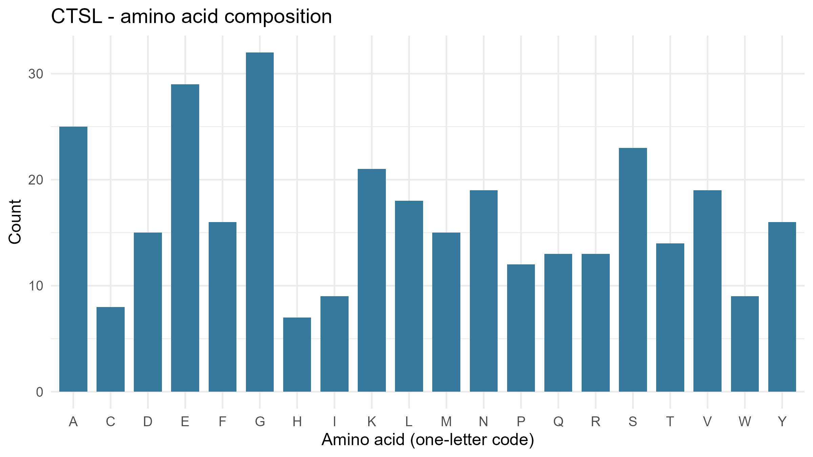
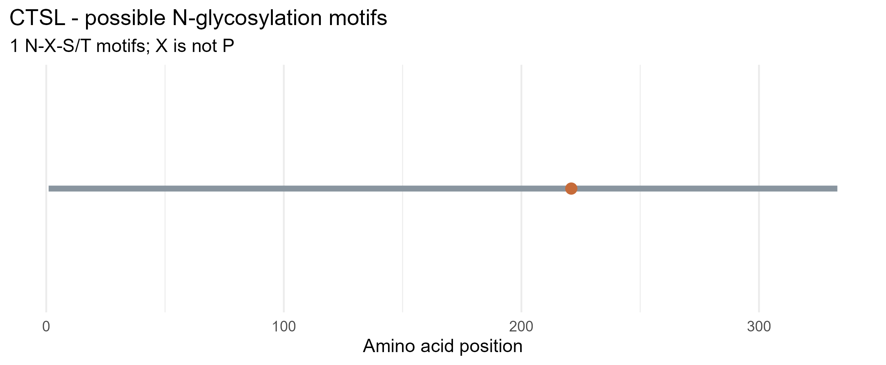

# Lysosomal Enzyme Sequence Analysis: CTSL

## 1. Introduction

This project focuses on the sequence analysis of the human lysosomal enzyme Cathepsin L, encoded by the *CTSL* gene. The objective is to examine its protein length, amino acid composition, and potential N-glycosylation motifs using NCBI and R.

## 2. Enzyme Information

- **Gene Symbol:** CTSL
- **Enzyme Name:** Cathepsin L
- **Protein Accession:** NP_001903.1
- **Organism:** *Homo sapiens*
- **NCBI Protein Record:** [NP_001903.1](https://www.ncbi.nlm.nih.gov/protein/NP_001903.1)

**Normal Function:**  
Cathepsin L is a lysosomal cysteine protease involved in breaking down proteins into smaller peptides. It contributes to intracellular protein degradation and normal lysosomal function.

## 3. Methodology

The human CTSL protein sequence was retrieved from NCBI Protein in FASTA format using the `rentrez` package in R.

The protein sequence was analyzed using R to determine:
1. Total protein length.
2. Amino acid composition, counts, and percentages.
3. Potential N-glycosylation motifs (N-X-S/T), where X is not proline.
4. Positions and sequences of potential N-glycosylation motifs.

The results were summarized using CSV files, and figures were generated using the `ggplot2` package.

## 4. Results

### 4.1 Protein Length and Potential N-Glycosylation Motifs

The analyzed CTSL protein sequence has a total length of **333 amino acids**. A total of **1 potential N-glycosylation motif** was identified in the sequence.

| Parameter | Result |
|---|---|
| Gene | CTSL |
| Protein Accession | NP_001903.1 |
| Protein Length | 333 amino acids |
| Potential N-Glycosylation Motifs | 1 |
| Motif Sequence | NDT |
| Motif Position | 221–223 |

### 4.2 Amino Acid Composition

The amino acid composition analysis showed that **glycine (G)** was the most abundant amino acid, with 32 residues (9.61%). This was followed by glutamic acid (E), with 29 residues (8.71%), alanine (A), with 25 residues (7.51%), and serine (S), with 23 residues (6.91%).

### Figure 1. Amino Acid Composition of CTSL

The figure illustrates the distribution of the 20 standard amino acids in the CTSL protein sequence, with glycine showing the highest count.

### 4.3 Potential N-Glycosylation Motif Analysis

One potential N-glycosylation motif, **NDT**, was detected at amino acid position **221–223**, beginning at position 221.

### Figure 2. Potential N-Glycosylation Motif in CTSL

The figure shows the location of the detected potential N-glycosylation motif along the CTSL protein sequence.

## 5. Questions and Answers

### 1. What does your enzyme normally break down inside lysosomes?

Cathepsin L, encoded by the *CTSL* gene, is a lysosomal cysteine protease that breaks down proteins into smaller peptides, contributing to intracellular protein degradation and turnover.

### 2. What is the total length of your protein, and which amino acids are most common?

The CTSL protein sequence analyzed has a total length of **333 amino acids**. The most common amino acids are glycine (G), with 32 residues (9.61%); glutamic acid (E), with 29 residues (8.71%); alanine (A), with 25 residues (7.51%); and serine (S), with 23 residues (6.91%).

### 3. How many potential N-glycosylation motifs did you find? Where are they located?

I identified **one potential N-glycosylation motif**, NDT, located at amino acid positions **221–223** of the CTSL protein sequence. This motif follows the N-X-S/T pattern, where X is not proline.

### 4. Why can glycosylation matter for lysosomal proteins? Does finding a motif prove the protein is glycosylated?

Glycosylation can contribute to proper protein folding, stability, and intracellular trafficking of lysosomal proteins. However, identifying an N-X-S/T motif does not prove that the protein is glycosylated because it only indicates a potential glycosylation site.

### 5. What could happen in the cell if your enzyme did not work properly?

If Cathepsin L does not function properly, protein degradation may be impaired, potentially causing undegraded materials to accumulate and disrupting lysosomal function and normal cellular processes.

## 6. Conclusion

The sequence analysis of the human CTSL protein revealed a length of 333 amino acids, with glycine as the most abundant amino acid. One potential N-glycosylation motif, NDT, was detected at positions 221–223. These findings provide information about the protein's sequence characteristics and potential glycosylation site. However, sequence analysis alone cannot confirm actual glycosylation or enzyme activity.

## 7. Generated Files

- `lysosomal_enzyme_analysis.R` – R analysis script.
- `data/CTSL.fasta` – Downloaded CTSL protein sequence.
- `results/CTSL_summary.csv` – Protein length and motif summary.
- `results/CTSL_amino_acid_counts.csv` – Amino acid counts and percentages.
- `results/CTSL_motif_positions.csv` – Motif sequences and positions.
- `figures/CTSL_amino_acid_composition.png` – Amino acid composition figure.
- `figures/CTSL_potential_N_glycosylation.png` – Potential N-glycosylation motif figure.

## 8. References

1. National Center for Biotechnology Information (NCBI). CTSL protein sequence, NP_001903.1.  
   https://www.ncbi.nlm.nih.gov/protein/NP_001903.1

2. National Center for Biotechnology Information (NCBI).  
   https://www.ncbi.nlm.nih.gov/
   
